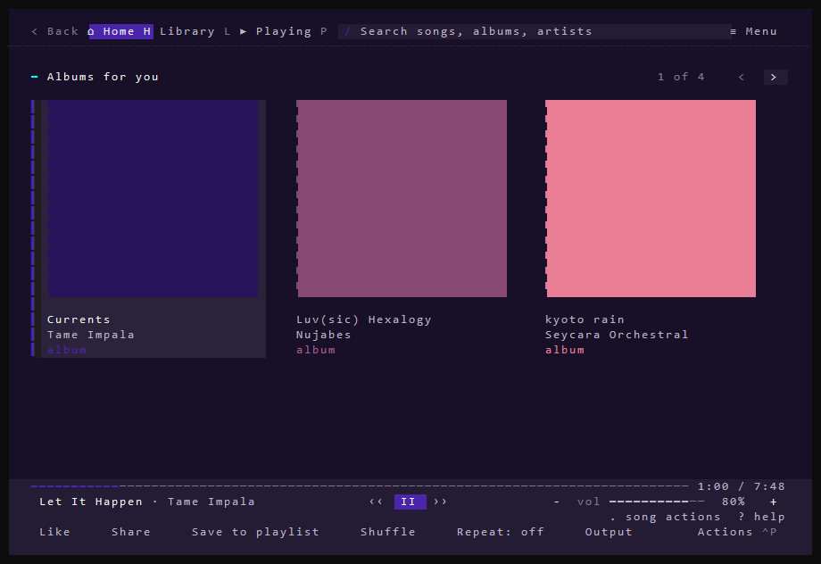
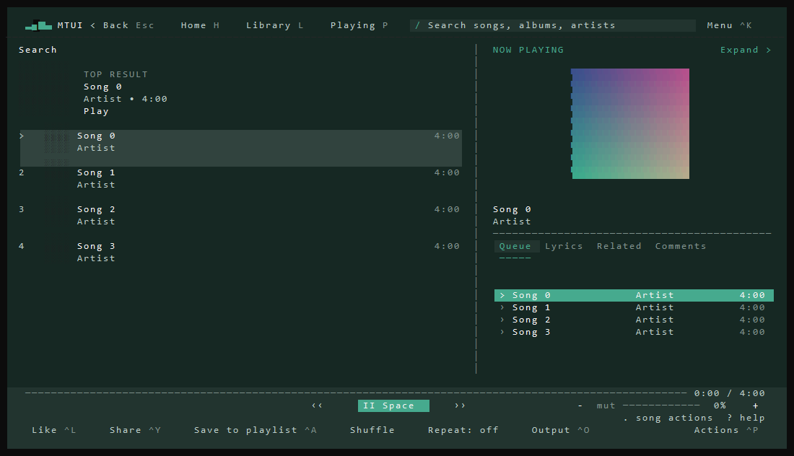
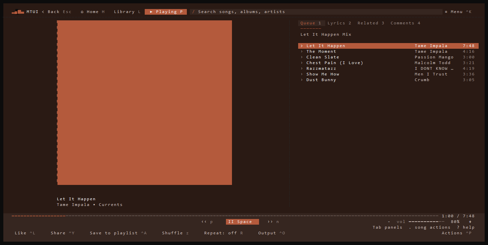

# MTUI v0.11.8

- Keep browsing open when playback starts and resize Now Playing panels.
- Improve Windows terminal rendering and artwork loading.
- Clear private browsing and playback state across account changes, bind history delivery to its original session, and prevent stale sign-in from undoing logout.
- Harden Unix journal permissions, Discord peer checks, managed executables, Linux updates, and lyric parsing.

## Screenshots

