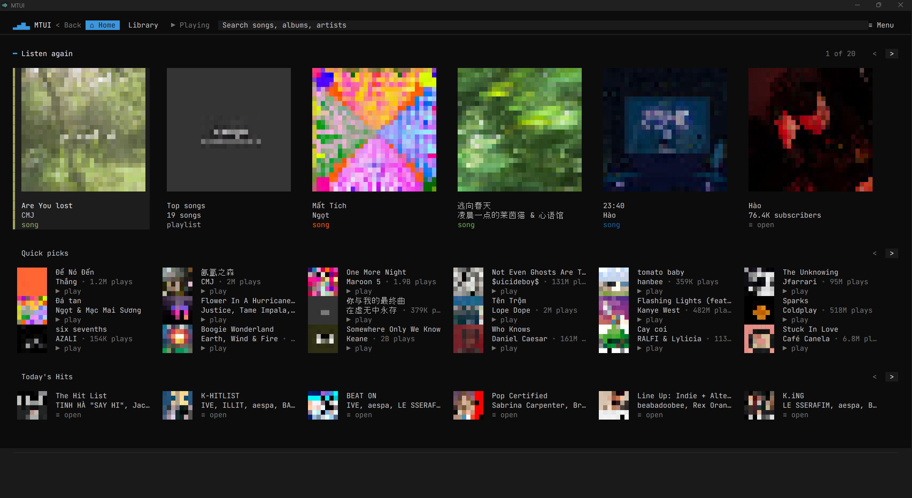
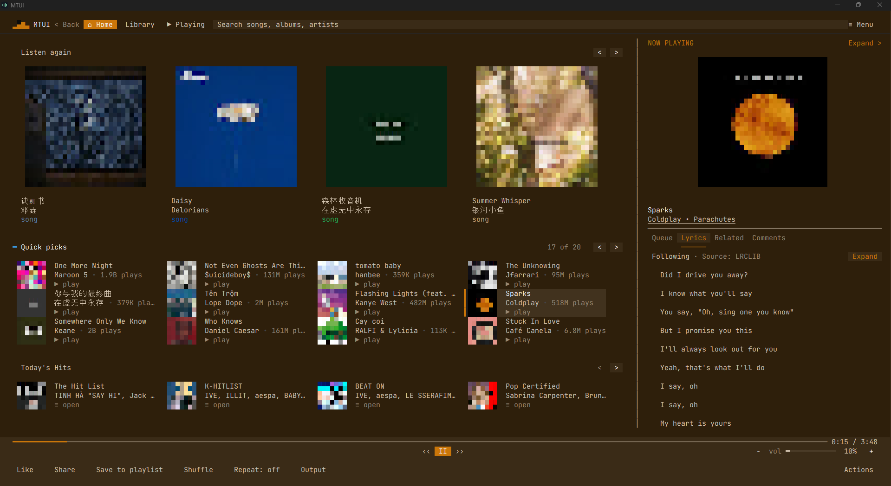
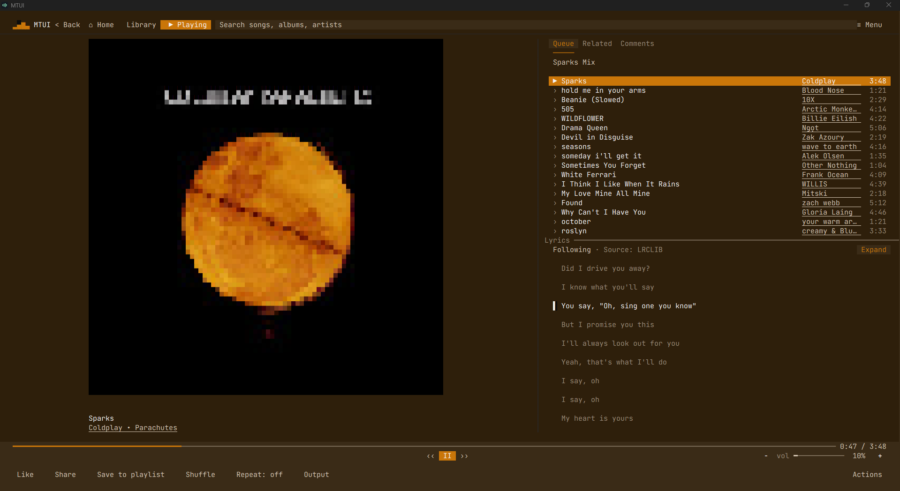

# MTUI v0.11.8 — Browse and listen together

This update focuses on keeping your listening context while browsing and viewing lyrics. Thanks to @Braeed for describing the interruptions in #7 and #9.

- **Keep browsing when you play a track.** Starting a song leaves the browsing page open, with the current track visible in a persistent Now Playing sidebar. This addresses the repeated page switching raised in [#7](https://github.com/lightzgls/mtui/issues/7). Search continues to use its dedicated page, and Now Playing remains accessible through navigation.
- **See the queue and lyrics together.** Now Playing keeps lyrics below the selected Queue, Related, or Comments panel. Drag the dividers to adjust the space for artwork, details, and lyrics. This addresses having to alternate between queue and lyrics in [#9](https://github.com/lightzgls/mtui/issues/9).
- **Songs-only search remains available.** Select the existing Songs filter to leave videos out of the results, as discussed in [#8](https://github.com/lightzgls/mtui/issues/8). Mixed search still includes the other result types.
- **More room between queued songs.** A blank line separates songs in both the expanded Now Playing view and the persistent Now Playing sidebar. Scrolling, selection, artist links, and drag targets follow the spaced rows; blank lines do not activate songs.
- Improve Windows terminal rendering and artwork loading.
- Clear private browsing and playback state across account changes, bind history delivery to its original session, and prevent stale sign-in from undoing logout.
- Harden Unix journal permissions, Discord peer checks, managed executables, Linux updates, and lyric parsing.

## Queue spacing refresh

This same-version refresh adds the queue spacing fix without changing the original v0.11.8 tag. The published release description records the verified build's source commit and workflow run.

Already on v0.11.8? Reinstall the refreshed installer or replace the portable executable to get this fix. Linux users can rerun the installer or reinstall the refreshed package. The in-app updater does not offer equal-version refreshes.

## Screenshots

